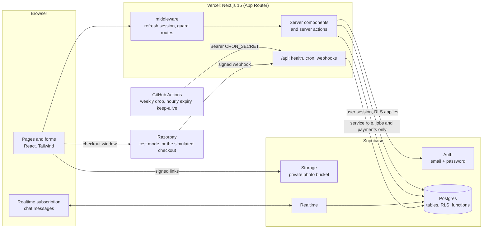
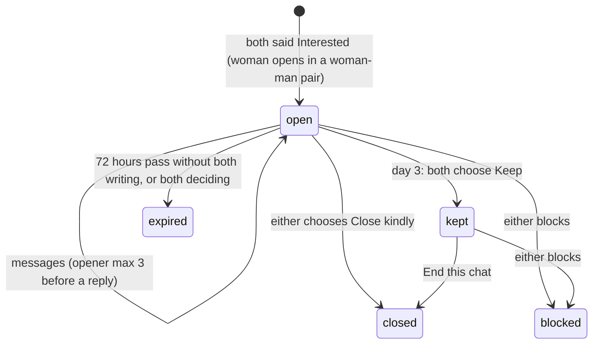

# Architecture

How Shortlist is put together, why, and where the rules live. The reasoning behind the product choices is in `decisions.md`; this file is the map of the code.

## The shape of it



In words: the browser talks to Next.js. Next.js talks to Supabase either **as the signed-in person** (so the database's row level security applies) or, in a few well-fenced places, **as the server** with the service role key. The browser also holds one direct Realtime connection for live chat messages, protected by the same row level security. Scheduled work is not run by a server of mine: GitHub Actions calls protected URLs on a timer.

## Folder map

| Folder                 | What is in it                                                                                                                                                    |
| ---------------------- | ---------------------------------------------------------------------------------------------------------------------------------------------------------------- |
| `app/`                 | Routes. Server components render pages; server actions (`actions.ts` next to a page) take form posts. `app/api/` has health, the cron endpoints and the webhook. |
| `components/`          | UI pieces, grouped by feature (`chat`, `shortlist`, `plus`, `safety`, ...). `components/ui` is the shadcn/ui base.                                               |
| `config/`              | Every number and list the rules use: matching weights, intro and chat caps, the 72 hour window, plans and prices, values questions, prompts, demo logins.        |
| `lib/`                 | The logic, as small modules. Pure rules (no database) sit next to thin adapters that talk to Supabase, so the rules can be tested alone.                         |
| `supabase/migrations/` | The database: tables, enums, row level security, and the functions that change state (twelve files, applied in order).                                           |
| `scripts/`             | The seed, the icon generator, the smoke test, and the local test harness (`scripts/test/`).                                                                      |
| `tests/`               | `unit` (pure logic), `rls` (every migration run in an in-process Postgres), `integration` (real local Supabase), `e2e` (Playwright in a real browser).           |
| `docs/`                | This file, the decision log, the credits, and the deploy guide.                                                                                                  |

## Data model (summary)

```
auth.users 1-1 profiles ---< consents                (versioned, per kind)
                    |  \---< blocks, reports        (reports survive deletion as a minimal record)
                    |
 drops ---< intros (viewer, candidate, score, reasons, status)
                    |
                    +--> conversations (user_a, user_b, opener, status, window_ends_at)
                              |           ---< messages
                              |           ---< conversation_reads (own row only)
 orders (user, provider order id, plan, amount, status)   events (names and counts, no content)
 audit_log (admin, action, target)                        contact_messages
```

- `profiles` holds what the app shows and uses: name, gender, city, intent, batch year, prompts, values answers, interests, photo paths, the eLitmus status, the reply-rate counters and the Plus end date. The birth date and the pH ID hash exist but are **not readable** by any API role; the app asks for an age through a function.
- `intros` are the weekly shortlist rows. One row per viewer and candidate per drop.
- `conversations` have one live row per pair (a unique index), a status of `open`, `kept`, `closed`, `expired` or `blocked`, and a 72 hour window. The two people's Keep/Close choices are columns nobody can read through the API.
- `orders` is written only by the server. `plus_until` on the profile is the entitlement.
- `events` records that something happened (a drop ran, an intro was answered), never what was said.

## Matching

The weekly drop is a pure function: `buildDrop(members, history, config, seed)` in `lib/matching/`. It does not touch the database; an adapter reads members and history in, and one database function (`write_drop`) saves the result in a single transaction.

1. **Hard filters**: same city, mutual gender interest, ages within 6 years, compatible intents, no block either way, not shown to you in the last 8 drops, no live chat already. These are never traded against the score.
2. **Score** from 0 to 1: values answers (35%, deal-breakers count double), shared interests (20%), batch closeness (15%), intent (10%), how often the person replies (10%), a freshness bonus for people rarely shown (10%). Below 0.30 nobody is shown: a thin pool gives fewer intros, not weak ones.
3. **Assignment**: people take turns in a seeded random order, each taking their best remaining candidate who is in fewer than 5 shortlists, until quotas are met (3 free, 5 Plus). It is greedy, not optimal (the optimum is a flow problem); I chose it because it is easy to explain and the loss is small when the cap is bigger than the quota.
4. **Reasons**: the two strongest signals become two plain sentences that name a topic, never an answer.

The weights and numbers are in `config/matching.ts`. The same seed gives the same drop, which is what lets the tests assert exact outcomes.

## The conversation lifecycle



The rules are written twice on purpose: once as a pure TypeScript function (`lib/conversation/state.ts`, `lib/shortlist/decide.ts`) and once as database functions (`send_message`, `record_decision`, `expire_conversations`, `decide_intro`). A test runs a large matrix of cases through both and requires the same answer, so the readable version and the enforced version cannot drift apart.

## Security model

- **Row level security (RLS) on every table.** A person can read their own profile, and the profile of someone they were shown or are chatting with, and nobody else's. There is no public browse. Admins get read access to the admin views, not to message text.
- **Column privileges.** Users cannot write `role`, `plus_until`, `elitmus_status` or the onboarding flag, and cannot read the birth date, the pH hash or the other person's decision.
- **State changes go through functions.** Sending a message, answering an intro, blocking, reporting, deleting an account and granting Plus are `SECURITY DEFINER` functions that re-check who is calling, lock the rows they change, and write the audit row in the same transaction. The sensitive ones are callable by the server only (`service_role`), after the server has validated the session.
- **The service role** key lives only in server code (`lib/supabase/admin.ts`), for the jobs, payments and moderation that must act beyond one user.
- **Every input is validated with Zod** on the server, whatever the browser did. React escapes output; nothing uses `dangerouslySetInnerHTML`.
- **Admin pages** call `requireAdmin()` on every request and every action, and answer 404 to anyone else.
- **Headers** (`lib/security-headers.ts`): a Content Security Policy that allows only this site, the Supabase host and Razorpay Checkout; HSTS and the https upgrade on https; no framing; `nosniff`; a strict referrer policy; a permissions policy that switches off camera, microphone and location and allows `payment` for the Razorpay frame. `script-src` still allows inline scripts because Next.js needs them without a per-request nonce; that trade-off is stated in the file.
- **Cron and webhooks** use a bearer secret or an HMAC signature, compared in constant time, and refuse everything when the secret is not set.
- **Photos** are in a private bucket, shown by short-lived signed links, with EXIF removed in the browser before upload.
- **Rate limits** (messages, reports, blocks, exports, orders) are counted from the database, because a serverless app has no memory to count in.

## Scheduled jobs

GitHub Actions calls three protected endpoints. They are idempotent, so a late or doubled run is harmless.

| Job          | Schedule                     | Endpoint                   | Does                                                                        |
| ------------ | ---------------------------- | -------------------------- | --------------------------------------------------------------------------- |
| Weekly drop  | Sunday 14:30 UTC (20:00 IST) | `POST /api/cron/drop`      | Builds and saves the week's shortlists.                                     |
| Expire chats | hourly                       | `POST /api/cron/expire`    | Ends chats past their window, updates reply rates, retries waiting matches. |
| Keep alive   | every 3 days                 | `POST /api/cron/keepalive` | One tiny query so a free Supabase project does not pause.                   |

## Payments

Everything goes through one interface, `PaymentProvider` (`lib/payments/`), with two implementations: Razorpay in test mode (Orders API over `fetch`, Checkout in the browser) and a simulated one with a fake checkout page and the same signing. The environment picks one (`select.ts`), and a half-set configuration is an error, never a quiet fall-back.

An order is created on the server with the price from `config/plans.ts`. Two things may then arrive in either order: the browser callback (a server action checking `HMAC-SHA256(order_id|payment_id, key_secret)`) and Razorpay's webhook (`HMAC-SHA256(raw body, webhook_secret)`). Both call `grant_plus`, which locks the order, checks member, amount and currency, marks it paid once and adds the days. A repeat changes nothing. Entitlements (`lib/plus.ts`) are read in one place: the chat cap, the intros per drop, the why-we-matched detail and the second look. A test asserts that safety, verification, data tools and the core weekly intros never look at Plus.

## Testing pyramid

| Layer          | Command                    | What it covers                                                                                                                                  | Needs      |
| -------------- | -------------------------- | ----------------------------------------------------------------------------------------------------------------------------------------------- | ---------- |
| Unit           | `npm test`                 | Pure rules: matching, caps, the chat state machine, validators, signatures, headers, the admin metrics, the smoke checks.                       | nothing    |
| Database (RLS) | `npm test` (same run)      | Every migration run in an in-process Postgres (PGlite), acting as different users: who can read what, atomic functions, TypeScript/SQL parity.  | nothing    |
| Integration    | `npm run test:integration` | Real clients against a real local Supabase: auth emails, RLS from real sessions, storage, true parallelism, Realtime, cron over HTTP, deletion. | Docker     |
| End to end     | `npm run test:e2e`         | Playwright in Chromium, desktop and a Pixel 5 screen, with axe-core accessibility checks on the key pages.                                      | Docker     |
| Everything     | `npm run test:all`         | Starts the stack and the app, runs both suites, stops it all.                                                                                   | Docker     |
| After a deploy | `npm run smoke -- <url>`   | Health, public pages, refused cron calls, security headers; optionally a login.                                                                 | a live URL |

Not covered by any automated test, and said so in the README: the hosted Supabase project, a real Razorpay payment, real email delivery, and real devices or screen readers.
